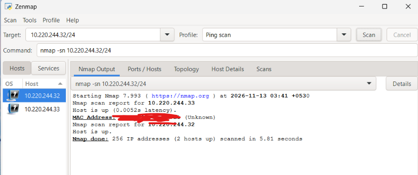
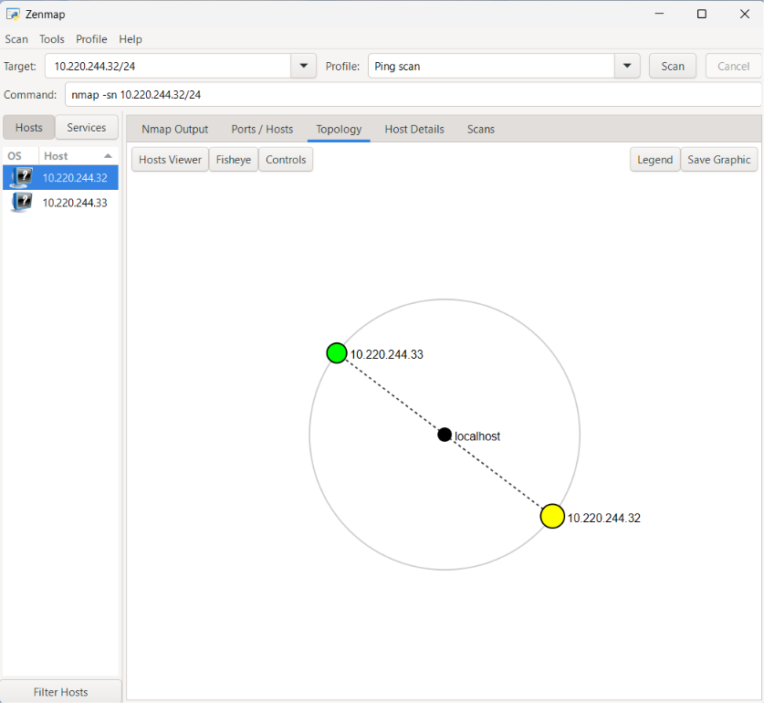

# Network Scanning with Zenmap

> **Lab:** Week 2 -- Project Module 5\
> **Topic:** Network Scanning with Zenmap\
> **Platform:** Windows\
> **Tool:** Zenmap (Nmap GUI)\
> **Author:** `Your Name`\
> **Date:** `DD Month YYYY`

## 1. Objective

The objective of this lab is to use Zenmap to discover live devices on a
local network, identify their IP and MAC addresses, and visualize the
discovered hosts using the network topology feature.

The scan should only be performed on a network that you own or have
explicit permission to assess.

## 2. Introduction

Zenmap is the official graphical user interface (GUI) for Nmap. It makes
Nmap easier to use by providing a graphical interface while retaining
access to its network-scanning capabilities. It is available for
multiple platforms, including Windows, Linux, and macOS.

Zenmap also allows frequently used scans to be saved as profiles so they
can be run again.

## 3. Lab Environment

  Item               Details
  ------------------ -------------------------------------------
  Operating system   Windows
  Scanning tool      Zenmap
  Scan type          Ping Scan
  Target             Local LAN subnet
  Purpose            Host discovery and topology visualization

*Replace or add details above to match the system you used.*

## 4. Procedure

### Step 1 -- Install and launch Zenmap

1.  Download Zenmap/Nmap from the [official Nmap download
    page](https://nmap.org/download.html).
2.  Install the software.
3.  Launch Zenmap.

### Step 2 -- Identify the local IP address and subnet

Open Command Prompt and run:

``` cmd
ipconfig
```

Identify the active network adapter and record its IPv4 address and
subnet information.

  Network detail               Your result
  ---------------------------- --------------------
  IPv4 address                 `YOUR_LOCAL_IP`
  Subnet mask                  `YOUR_SUBNET_MASK`
  LAN subnet / network range   `YOUR_LAN_SUBNET`

For example, a network using `10.0.0.0/24` has a scan range of
`10.0.0.0/24`. This is only an example; use the subnet belonging to your
own network.

### Step 3 -- Discover live hosts with Ping Scan

1.  Open Zenmap.
2.  Enter your LAN subnet in the **Target** field.
3.  Select **Ping Scan** from the **Profile** list.
4.  Start the scan.
5.  Review the discovered hosts in the scan output.

**Screenshot -- Ping Scan**



*Evidence: Replace this image path with your Ping Scan screenshot.*

### Step 4 -- Record the live hosts

Count the hosts reported by your scan and record their IP addresses.

**Total live hosts discovered:** `ENTER_COUNT`

    No. Live host IP address   Hostname (if shown)
  ----- ---------------------- ---------------------
      1 `IP_ADDRESS_1`         `HOSTNAME_OR_N/A`
      2 `IP_ADDRESS_2`         `HOSTNAME_OR_N/A`
      3 `IP_ADDRESS_3`         `HOSTNAME_OR_N/A`
      4 `IP_ADDRESS_4`         `HOSTNAME_OR_N/A`

*Add or remove rows to match your actual scan results. Do not copy the
example addresses from the training handout as your own results.*

### Step 5 -- Identify MAC addresses

Review the scan output for MAC address information. MAC addresses may be
shown when the scan environment and network conditions allow Zenmap/Nmap
to obtain them.

For the local Windows computer, you can also run:

``` cmd
ipconfig /all
```

Find the **Physical Address** entry under the active network adapter.

**Screenshot -- MAC address results**


*Evidence: Replace this image path with your MAC address screenshot.*

    No. IP address       MAC address       Vendor (if identified)
  ----- ---------------- ----------------- ------------------------
      1 `IP_ADDRESS_1`   `MAC_ADDRESS_1`   `VENDOR_OR_UNKNOWN`
      2 `IP_ADDRESS_2`   `MAC_ADDRESS_2`   `VENDOR_OR_UNKNOWN`
      3 `IP_ADDRESS_3`   `MAC_ADDRESS_3`   `VENDOR_OR_UNKNOWN`
      4 `IP_ADDRESS_4`   `MAC_ADDRESS_4`   `VENDOR_OR_UNKNOWN`

*Only enter MAC addresses actually observed. A MAC address may not be
available for every discovered host.*

### Step 6 -- Generate the network topology

1.  Open the **Topology** tab in Zenmap.
2.  Enable the legend.
3.  Review the topology and the information represented by its symbols.
4.  Save the topology graphic.
5.  Select PDF as the output format if you need to submit a PDF copy.

**Screenshot -- Network Topology**



*Evidence: Replace this image path with your topology screenshot.*

**Topology PDF:** `reports/zenmap-topology.pdf` *(optional; add your
exported PDF to this location if you want to keep it in the
repository).*

## 5. Results Summary

Complete this table using your actual scan output.

  Check                                    Result
  ---------------------------------------- ---------------
  Local IPv4 address identified            `YES / NO`
  LAN subnet identified                    `YES / NO`
  Ping Scan completed                      `YES / NO`
  Number of live hosts                     `ENTER_COUNT`
  IP addresses recorded                    `YES / NO`
  MAC addresses recorded where available   `YES / NO`
  Network topology generated               `YES / NO`
  Topology exported to PDF                 `YES / NO`

## 6. Key Observations

-   Ping Scan was used to identify hosts responding on the specified
    local subnet.
-   The scan output provided the discovered host information, including
    IP addresses.
-   MAC address information was recorded where it was available.
-   The Topology view provided a graphical representation of the
    discovered network hosts.
-   Scan results depend on the local network configuration and the
    devices reachable during the scan.

## 7. Conclusion

This lab demonstrated how to use Zenmap for basic local network
discovery. I identified my local network range, performed a Ping Scan,
recorded the live hosts and available MAC addresses, and generated a
network topology view.

The exercise provided practical experience with host discovery and
interpreting basic network scan results.

## 8. Repository Evidence

Suggested repository layout:

``` text
.
├── zenmap.md
├── images/
│   ├── zenmap-ping-scan.png
│   ├── zenmap-mac-addresses.png
│   └── zenmap-topology.png
└── reports/
    └── zenmap-topology.pdf
```

Create the `images/` and `reports/` folders in your GitHub repository
and upload your screenshots using the filenames shown above. If your
filenames differ, update the image paths in this Markdown file.

------------------------------------------------------------------------

**Reference:** Week 2 -- Project Module 5, *Network Scanning with
Zenmap* (training handout).\
**Official tool download:** <https://nmap.org/download.html>
